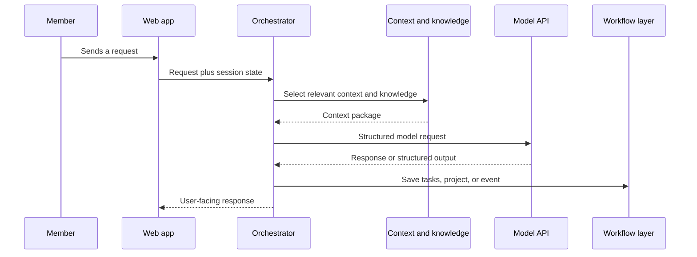
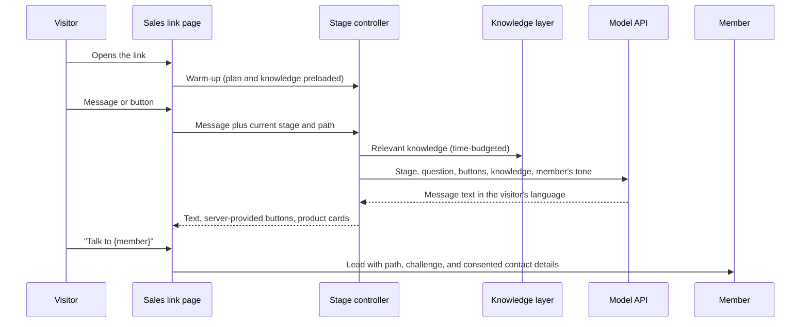
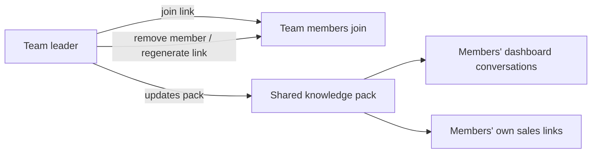
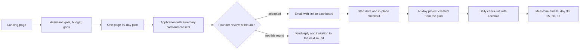
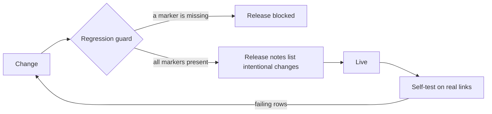

# Product architecture

This document explains the TalkToLorenzo system at a public, product-architecture level. It deliberately omits proprietary implementation details, prompts, credentials, and internal data structures.

## Design objective

TalkToLorenzo is designed to move beyond single-turn answers. Its central requirement is continuity: the system should understand what the user was working on, preserve useful context, and help identify the next valuable action.

Since mid-2026 the same requirement has been extended outward. The platform now also talks to its members' visitors (personal sales links and campaign assistants), and the architecture has had to stay reliable while changing every week.

## Core components

### 1. Conversation experience

The web interface provides multilingual conversations and access to saved work. The goal is to make specialist modes feel like one coordinated team rather than disconnected chatbots.

### 2. Orchestration and routing

The orchestration layer determines which specialist mode, context, tools, and workflow are relevant to a request. It also normalizes outputs so they can be saved or acted on elsewhere in the product.

### 3. Context and continuity

The product assembles relevant context from the current conversation, prior work, the active project or journey, and user state. Long-term usefulness depends on selecting the right context, not simply passing every previous message back to a model.

### 4. Structured work layer

Useful conversation outputs can become:

- projects with a goal, a duration, and phases;
- journeys;
- tasks and next steps;
- saved resources;
- decisions, daily check-ins, and progress markers;
- qualification or handoff events.

This layer connects a model response to an ongoing piece of work.

### 5. Knowledge layer

Each member builds their own knowledge packs: documents, product catalogues, photos, and videos about their business. Knowledge is indexed in memory and ranked by relevance (term rarity, frequency, and coverage of the question), so the most relevant passages reach the model first within a strict time budget. Key concepts are also matched across languages, so a Spanish guide can answer an English or Hungarian question.

Packs are private by default. A pack is visible only to its owner and to the members it has been shared with (see *Knowledge sharing* below).

### 6. Personal AI sales links

Every paying member has a public sales link. A visitor's conversation is handled by a dedicated sales pipeline that shares the knowledge layer with the dashboard but has its own conversation control (see *Server-led conversation* below).

### 7. Campaign layer

Campaigns such as the 60-Day Accelerator run as their own "hat" on the platform: a dedicated landing page, a dedicated assistant, and a funnel record per person with a timestamp for every milestone. After payment, a campaign participant becomes an ordinary member, so the dashboard, projects, and daily check-ins are reused rather than rebuilt.

### 8. Attribution and human handoff

The system connects a conversation to lead attribution, qualification, routing, and a human follow-up. The aim is to preserve the context already gathered (for sales links: the visitor's chosen path and challenge) instead of forcing the visitor to repeat it.

### 9. Quality system

A built-in self-test and a regression guard protect existing behaviour across frequent releases (see *Quality system* below).

## Simplified request flow (dashboard)

## Server-led conversation (sales links)

Prompt-only sales flows proved unreliable: the model would merge or skip steps, offer buttons that did not answer its own question, or name the product too early. The sales link therefore separates **control** from **wording**.

**Stages:** greeting → situation and path question → challenge → mirror, advice, and how it works → offer → open advice. The server provides the buttons for every stage; the last sentence of each message is always the question the buttons answer, and the visitor can always reply in their own words instead.

**Paths:** the first question selects a path (why the visitor came). Each path has its own challenges, explanation, and offer. A template is chosen automatically from the link's knowledge and the member's business identity, and the member can override every part.

**Rules that stay on the server:**

- A price question, a trial request, or a request to talk moves straight to the offer.
- A side question gets a full answer, and the guided question waits for the next turn.
- Advice is woven into the sentence; chatbot-style labels and "according to my documents" phrasing are removed server-side if the model produces them.
- No health or income claims, numbers only from the member's knowledge, and the AI never claims personal experience.
- Model calls run within a fixed time budget, because the hosting platform cuts long requests.

## Knowledge sharing and duplication

- **One pack per member**, shared as a whole through a join link that can be revoked by regenerating it.
- **Visibility:** the owner plus the members who joined, never the whole community by default.
- **Isolation:** a sales link uses only the knowledge assigned to it, which matters when members represent competing companies.
- **Best practices** complement packs: a successful campaign is merged into one document (personal data removed automatically), shared by email or link, and adopted by the recipient as their own project, rewritten day by day in their language and for their business. The sender sees progress, never conversations.

## 60-Day Accelerator funnel

Design choices:

- **Human selection is real.** The cohort size equals the purchase limit of the plan, so "30 places" is a true statement, and only accepted applicants can pay.
- **No separate thank-you or onboarding site.** Everything after acceptance happens on the dashboard, and the project is seeded from the plan the participant already wrote, so Lorenzo starts with the first step instead of asking for the goal again.
- **Reuse over special cases.** Reminders and daily check-ins are the same as for every member; only the welcome, the seeded project, and the milestone emails are campaign-specific.
- **Isolation from existing links.** The campaign was added without changing the behaviour of existing sales links, which the regression guard verifies.

## Trilingual delivery

- The visitor's or member's own language decides; it is detected per message, and buttons follow the language of each reply.
- Fixed texts (stages, campaign copy, emails) are authored in Hungarian, English, and Spanish. Other languages are translated once and cached.
- Generated plans and shared best practices are produced once per language and stored, so a recipient never waits for, or pays for, the same translation twice.
- Landing pages open in the browser's language, with English as the fallback.

## Quality system

- **Regression guard:** more than 100 registered markers, each tied to a behaviour that must keep working. The check runs before every release and also lists lines that disappeared since the previous version. New features add their own markers, and so does anything the founder reports as having worked better before.
- **Self-test:** a knowledge audit without AI (catalogue, photos, videos, response time), plus scripted multilingual conversations. Every test reply includes diagnostics showing which knowledge reached the answer, which turns "the answer was wrong" into a specific, fixable cause.
- **Defensive loading:** newer module functions are loaded defensively, so an outdated file in production degrades one feature instead of stopping every sales link.

## Key design decisions

### Continuity over novelty

The primary value is not another chat surface. It is preserving momentum between sessions and turning advice into follow-through.

### Orchestration over model training

TalkToLorenzo uses hosted model APIs. The core engineering and product work is orchestration: context selection, routing, structured workflows, memory behaviour, interface design, and operational integration.

### The server leads, the model writes

Where a flow must be reliable (sales conversations, campaign applications), the structure is deterministic and server-owned. The model is used for what it does well: wording, tone, language, and answering open questions from knowledge.

### Specialist modes with shared context

Specialists have different purposes, but they operate within a shared product experience. This reduces fragmentation and lets one workflow inform another.

### Working features never disappear silently

Weekly releases are only sustainable if regressions are caught before users see them. The guard and the self-test are part of the product, not an afterthought.

### Human escalation where it matters

AI is not treated as the correct endpoint for every interaction. Every sales conversation offers a human, campaign admission is a human decision, and qualified cases move into human workflows with the relevant context attached.

## Technology boundaries

- Wix and Velo provide the application and delivery environment.
- JavaScript backend modules implement product, conversation, and workflow logic; scheduled jobs handle reminders and milestone emails.
- Hosted model APIs provide language-model capabilities.
- Payment-provider integrations support subscriptions and one-time campaign plans.
- Private storage holds product state, knowledge, and user-specific continuity data.

No production endpoints, internal collection names, secret names, credentials, or security-sensitive configuration are disclosed in this repository.
