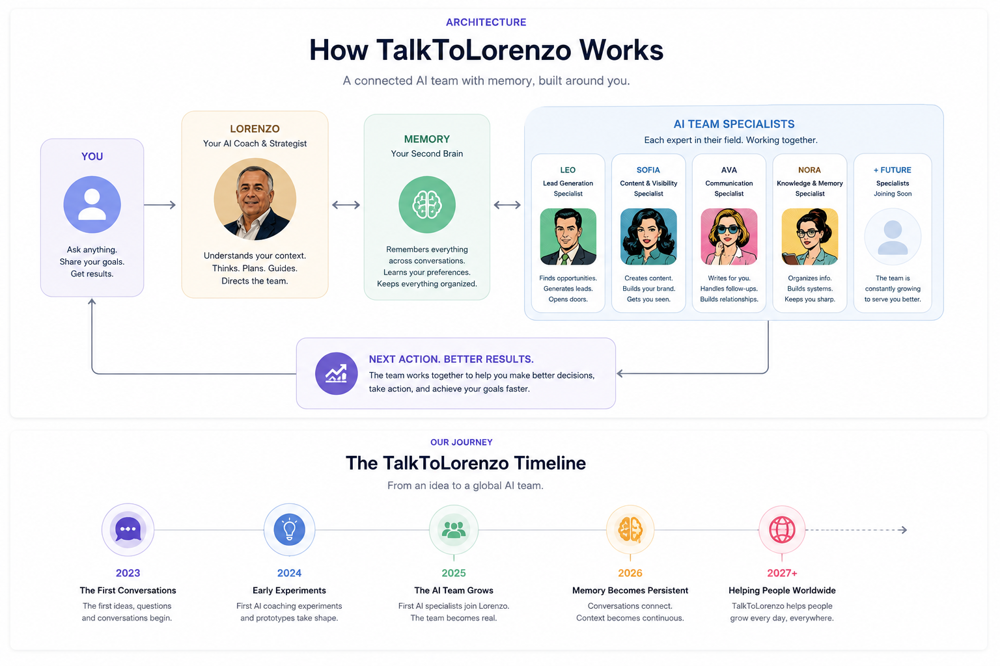
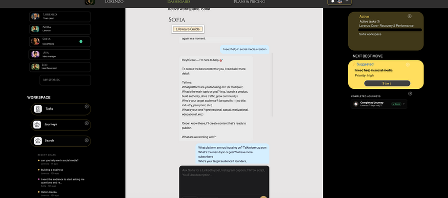
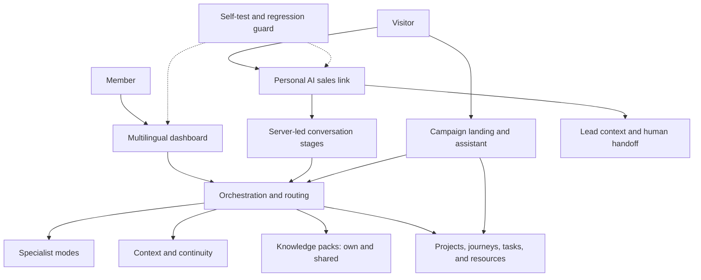

# TalkToLorenzo

### A continuity-first, multilingual AI workspace for entrepreneurs

[Live product](https://www.talktolorenzo.com) · [Founder](https://www.bestofyou.io) · [LinkedIn](https://www.linkedin.com/in/vojnits/)

> This is a public product and architecture showcase. Production source code, proprietary prompts, credentials, internal schemas, and user data remain private.

*A product-level view of the connected AI team, shared continuity layer, and the journey from early experiments to the current platform.*

## Why it exists

Most AI tools answer a question once. When the user returns, they often have to reconstruct the context and decide what to do next.

TalkToLorenzo was built around a different idea: **AI should remember where the work stopped and help move it forward.** It turns conversations into an ongoing workspace of saved journeys, projects, tasks, resources, decisions, and next steps.

## What the product does

- Maintains continuity across conversations and sessions
- Routes work to specialist AI modes with distinct responsibilities
- Converts conversations into structured projects, journeys, tasks, and resources
- Gives every paying member a **personal AI sales link** that runs a guided, server-led sales conversation for their own business
- Lets team leaders **share knowledge packs and best practices** with their teams, so what works can be duplicated
- Ships with a **built-in self-test and a regression guard**, so working features do not silently disappear between releases
- Runs time-boxed **campaigns** on the same architecture, starting with the 60-Day Accelerator
- Works end to end in **English, Spanish, and Hungarian**
- Connects AI conversations to attribution and human handoff workflows
- Supports white-label adaptations for different industries

## Product experience

The dashboard brings conversations, specialist modes, projects, tasks, journeys, saved resources, and suggested next actions into one workspace.

## The AI team

| Specialist | Role |
|---|---|
| **Lorenzo** | Business strategist, guide, and continuity layer |
| **Nora** | Knowledge architect |
| **Sofia** | Social media manager |
| **Leo** | Growth specialist |
| **Ava** | Communication specialist |

The specialists are not separate foundation models. They are product modes created through orchestration, context assembly, workflows, and purpose-specific interaction design.

## What is new (autumn 2026)

### Personal AI sales links

Every paying member gets a public link such as `talktolorenzo.com/u/<name>` (also under `/es/` and `/hu/`). Visitors talk to an AI sales assistant that speaks in the member's voice, uses only the member's own knowledge, and hands the conversation to the member whenever the visitor wants a human.

The key design decision: **the server leads the conversation, the model only writes it.** The conversation follows fixed stages built on Simon Sinek's Golden Circle (why → how → what). The server decides the stage, the question, and the answer buttons; the model writes the message for that stage in the visitor's language and the member's tone. This removed the typical failure modes of prompt-only flows: skipped steps, buttons that do not match the question, and product names dropped in too early.

- **Paths:** the first question identifies why the visitor came, and each path has its own challenges, explanation, and offer
- **Templates:** a working conversation out of the box for general services, entrepreneurs and coaches, network-marketing distributors (product interest and business opportunity as separate paths), and real estate; the member can rewrite every part, or let the AI draft it from their business identity
- **Always a human exit:** every reply ends with a "Talk to {member}" option, and a consent-based contact form that is never lost
- **Compliance by design:** no health or income claims, numbers only from the member's own knowledge, no fabricated personal experience, and an AI disclosure at the start
- **Lead context:** the chosen path and challenge travel with the lead, so the member sees why the visitor came

The sales link has gone through more than 60 releases since its launch.

### Knowledge-pack sharing for team duplication

Team leaders (for example in network marketing) can share their knowledge pack with their team through a join link. Members who join can use it in their own dashboard conversations and on their own sales link. When the leader updates the pack, such as a new compensation plan, everyone gets the new version immediately. Leaders see who joined, can remove anyone, and can regenerate the link.

Packs are **private by default**: an upload is visible only to its owner and the people it is shared with. Each sales link uses only the knowledge assigned to it, so members representing competing companies never see each other's material.

Alongside packs, **best practices** let a member turn a campaign that worked into a shareable template. The recipient adopts it in one click, and it becomes their own project, rewritten for their business and in their language.

### Self-test and regression guard

A product that changes weekly needs a way to prove that yesterday's features still work.

- **Self-test tab** for every sales link: a knowledge audit that runs without AI (catalogue, photos, videos, response-time budget), plus scripted conversations in all three languages covering the guided path, product and price questions, the full catalogue, and contact requests. Each test reply shows which knowledge actually reached the answer.
- **Regression guard:** every working behaviour is registered as a marker, now more than 100 of them. Before each release, an automated check confirms that every marker is still present and lists any lines that disappeared since the previous version. A release that would silently drop a feature does not go out.
- **Defensive modularity:** newer modules are loaded defensively, so a single outdated file cannot take down every sales link.

### The 60-Day Accelerator

The first time-boxed campaign built on the platform: *five AI specialists working on your goal for 60 days.*

- A dedicated landing page that opens in the visitor's browser language, mobile first
- A dedicated assistant that turns the visitor's goal, constraints, and gaps into a one-page 60-day plan, optionally sent by email
- Application inside the conversation, with an editable summary card and explicit consent
- **Real human selection:** the founder reviews every application within 48 hours, and only accepted applicants receive a payment link
- After payment, the member chooses a start date on the dashboard, and the 60-day project is **created automatically from their plan**. Lorenzo starts with the first step, followed by a two-minute daily check-in.
- Milestone emails on day 30, 55, 60, and +7, and funnel tracking for every stage from first visit to renewal

The first cohort of 30 starts on **9 November 2026**. The campaign layer is reusable: future rounds can run with other dates, prices, and messaging.

### Trilingual by design

English, Spanish, and Hungarian are handled as product behaviour, not as a translation pass:

- The visitor's own language decides; buttons follow the language of each reply, even in mixed-language conversations
- Conversation plans, greetings, and shared best practices are generated once per language and cached
- Cross-language retrieval: a Spanish guide can answer an English or Hungarian question
- Landing pages open in the browser language, with English as the fallback
- Product names are localised too: the dashboard is the *tervezőasztal* in Hungarian and the *sala de creación* in Spanish

## System view

For a deeper product-level view, see [Architecture](ARCHITECTURE.md) and the [Product walkthrough](PRODUCT-WALKTHROUGH.md).

### Detailed technical map

The public-safe [technical architecture map](technical-architecture-map.html) shows the scale of the founder-built implementation: its integration layer, specialist modes, sales links, knowledge sharing, campaign layer, quality system, data domains, multilingual delivery, and build profile. Production credentials, proprietary prompts, and internal schema names are intentionally omitted.

**[Open the visual technical architecture map](https://datamindly-collab.github.io/talktolorenzo-showcase/technical-architecture-map.html)**

## My role

I am **Bálint Vojnits**, the founder and product architect of TalkToLorenzo. I led the product from concept to a working, user-facing system, including:

- Product strategy and interaction design
- Full-stack delivery on Wix and Velo
- AI orchestration, routing, context, and memory design
- The server-led sales conversation framework and its industry templates
- Knowledge sharing and duplication features for team leaders
- The self-test and regression guard behind every release
- Campaign design and funnel for the 60-Day Accelerator
- Trilingual journeys and structured outputs
- Subscription, attribution, and human-handoff workflows
- Testing with real users and iterative product decisions
- White-label prototypes for real estate and e-commerce

I use AI coding tools as force multipliers, while retaining responsibility for product decisions, system design, integration, testing, and delivery.

## Technical implementation

| Layer | Implementation |
|---|---|
| Presentation | Wix, Velo, JavaScript, custom HTML components |
| Application | Velo backend modules, member state, workflow logic, scheduled jobs |
| AI | Hosted model APIs, orchestration, routing, context assembly, structured responses |
| Conversation control | Server-led stage machine, per-language cached plans, time-budgeted model calls |
| Knowledge | Member knowledge packs, in-memory indexes with relevance ranking, cross-language retrieval |
| Continuity | Conversation events, projects, journeys, tasks, resources, next-step logic |
| Commercial | Subscription plans, one-time campaign plans, payment-provider integration |
| Operations | Attribution, lead context, routing, human handoff, milestone emails |
| Quality | Built-in self-test, feature-marker regression guard, defensive module loading |

The system uses hosted AI models through APIs. I did not train a proprietary foundation model; the technical work is in turning model capabilities into a coherent, live product.

## White-label validation

The same core architecture has also been adapted into prototypes for:

- **Epique Mexico:** real-estate buyer, seller, and agent-recruitment journeys with qualification and routing
- **ShelfyCart:** an e-commerce adaptation exploring guided product discovery and conversion

These prototypes tested whether the underlying conversation, continuity, and workflow architecture could transfer beyond the original product.

## Current status

TalkToLorenzo is a live, evolving product used by real members. Personal sales links, the self-test, and the regression guard are live; knowledge-pack sharing is rolling out; the 60-Day Accelerator opens its first cohort on 9 November 2026. The product has not yet reached its full commercial target; the project remains an honest example of building, learning, and shipping under uncertainty.

## Repository scope

This repository contains:

- A public product overview
- Product-level architecture documentation
- A user and visitor journey walkthrough
- A public-safe technical architecture map
- Public screenshots

It intentionally does **not** contain:

- Production source code or internal schemas
- Proprietary prompts or orchestration rules
- API keys, credentials, or environment configuration
- Customer, conversation, or other personal data

## Contact

**Bálint Vojnits**  
[balint@bestofyou.io](mailto:balint@bestofyou.io) · [bestofyou.io](https://www.bestofyou.io) · [LinkedIn](https://www.linkedin.com/in/vojnits/)
